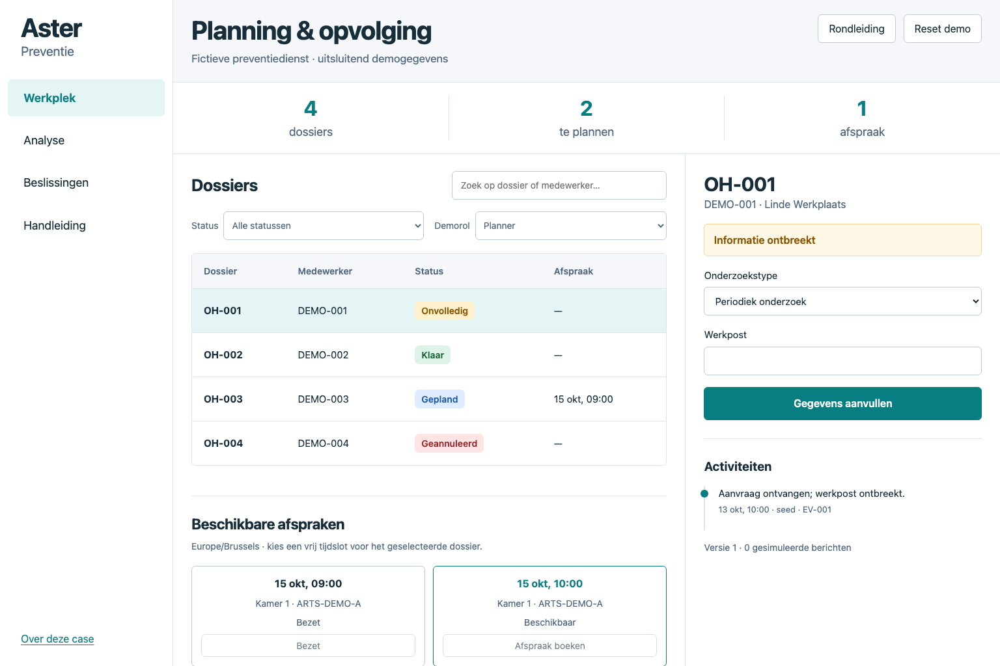

# Occupational Health · Software Analysis Case

**Van onvolledige aanvraag naar een controleerbare afspraak, annulering en herplanning.**

Aster Preventie is een fictieve preventiedienst. Deze case verbindt klantvragen, proces- en datamodellen, functionele specificaties, een werkend browserprototype en acceptatietests.

> Independent portfolio case study based on a fictional organisation. It contains no confidential information from any real employer or the hiring company.

[Live case](https://phlppgdfry.github.io/occupational-health-analysis-case/) · [Rondleiding · 2 min](https://phlppgdfry.github.io/occupational-health-analysis-case/demo/?tour) · [Start in 2/5/15 minuten](START-HERE.md) · [Case study](CASE_STUDY.md) · [Bewijs](EVIDENCE.md)



## Eén samenhangende analistencase

Klantvraag → discovery → requirements → proces en state machine → datamodel en API → prototype → acceptatietest → pilot → overdracht → meetplan.

De centrale vraag: **“Een annulering moet de vrijgekomen plek opnieuw beschikbaar maken.”** Volg P-03 → FR-04 → R-04 → AC-15 → K-04 in de [catalogus](docs/02-requirements/catalogue.md), [specificatie](docs/02-requirements/functional-spec.md), [domeinfunctie](site/assets/domain.mjs) en [test](tests/domain.test.mjs).

## Belangrijkste keuzes

- [Eerst volledige gegevens, dan reserveren](docs/adr/01-completeness.md): houdt capaciteit beschikbaar voor bruikbare aanvragen.
- [Toets overlap per middel en tijdsinterval](docs/adr/02-capacity.md): twee slot-ID's kunnen dezelfde arts dubbel boeken.
- [Annulering en herplanning zijn afzonderlijke acties](docs/adr/03-reschedule.md): vrijgave mag geen stilzwijgende nieuwe afspraak maken.

## Openen en controleren

Benodigd: Node.js 22+ en Python 3.11+. Het prototype en de domeintests hebben geen runtimepackages nodig.

```sh
git clone https://github.com/phlppgdfry/occupational-health-analysis-case.git
cd occupational-health-analysis-case
npm run dev
```

Open `http://localhost:8047/` voor de case of `http://localhost:8047/demo/?tour` voor de achtstappenrondleiding. Open HTML niet rechtstreeks als `file://`; de analysegegevens worden via fetch geladen.

```sh
npm run check
```

Verwacht: alle domein- en traceabilitytests geslaagd, relatieve links in orde, canonieke catalogus zonder drift, BPMN-referenties/DI en de basisstructuur van het contract gecontroleerd.

Browseracceptatie en screenshots:

```sh
npm ci
npx playwright install chromium
npm run test:ui
```

De browsercheck start zelf een tijdelijke server en controleert kernflow, opslag, filters, rol, tour, desktop en 375 px. Screenshots staan in `docs/screenshots/`. CI voert dezelfde checks uit. De publieke site wordt via GitHub Pages vanaf `site/` gepubliceerd; de workflow valideert de case opnieuw vóór deploy.

Volledige formatvalidatie en herbouwbare exports staan in [uitwisselvalidatie](docs/06-validation/exchange-validation.md). PDF's herbouwen: installeer de optionele `requirements-artifacts.txt` en voer `python3 scripts/export-pdfs.py` uit. De [ontwerpreferentie](docs/design/concept.png) en [visuele verificatie](docs/design/verification.md) documenteren desktop, mobiele indeling en bewuste functionele aanvullingen.

## Repositorykaart

| Pad | Inhoud |
|---|---|
| `docs/00-context` – `docs/10-value` | Analysejourney, aannames, discovery, specificaties, validatie, pilot en waarde |
| `docs/adr` | Vier beslissingen met alternatieven en grenzen |
| `docs/diagrams` | BPMN XML met DI en SVG-overzicht |
| `data/openapi.json` | API-ontwerpcontract; geen serverimplementatie |
| `site/assets/case.json` | Bron voor requirements, beslissingssamenvattingen en KPI-definities |
| `site/assets/domain.mjs` | Uitvoerbare, gedeelde domeinregels en fictieve seed-data |
| `site/demo` | Werkplek met zoeken, filters, formulieren, rollen en tour |
| `site/case` | Leesroute, traceerbaarheid en meetplan in de browser |
| `tests` / `scripts` | Acceptatie, browserchecks, links en modelconsistentie |
| `application-kit` | NL/FR/EN-samenvattingen en demoscripts |

## Bronnen, data en licenties

Zelf gegenereerde fictieve identifiers; geen echte persoonsgegevens. Geen externe runtimefonts of trackers. [Bronregister](docs/00-context/sources.md) verantwoordt standaarden, ontwerpreferentie en development dependency. Code: [MIT](LICENSE). Documentatie, diagrammen en data: [CC BY 4.0](LICENSE-DOCS.md).

## Grenzen van het bewijs

Dit is een uitgewerkte portfolio-case, geen klantimplementatie. Rolkeuze, notificaties en auditopslag zijn browsersimulatie. Geen klinische gegevens, echte login, backendtransacties of concurrencygarantie. KPI-getallen zijn illustratieve aannames, geen behaalde resultaten. De vaste demoklok houdt de voorbeelden reproduceerbaar. [Productievoorwaarden](docs/07-delivery/rollout.md) en [privacypunten](docs/04-design/privacy-security.md) blijven expliciet.

Bekijk [fallback-screenshots](docs/screenshots/README.md) wanneer de demo niet beschikbaar is.
