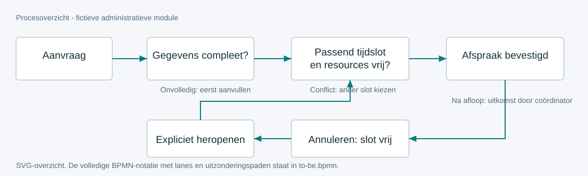
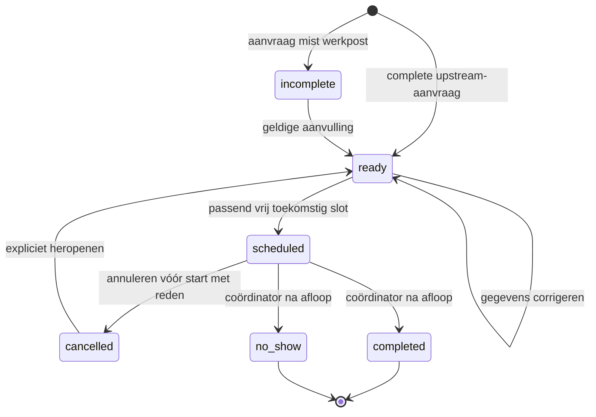

# Proces en dossierstatus

Voor module-owner en ontwikkelaar. Het proces beschrijft het werk; de state machine begrenst welke wijzigingen op één dossier toegestaan zijn.

## AS-IS

Trigger: aanvraag via e-mail. De planner kopieert de aanvraag naar een lijst, vraagt ontbrekende gegevens na en reserveert capaciteit in een afzonderlijk rooster. Bij annulering moet de planner beide lijsten herstellen. De coördinator verzamelt uitkomsten later.

Problemen: geen gezamenlijke bron voor capaciteit; onzekerheid over volledigheid; verschillende lijsten hebben verschillende statussen. Een dubbele boeking wordt vaak pas ontdekt na bevestiging. In de fictieve case zijn dit aannames uit discovery, geen gemeten feiten.

## TO-BE

De aanvraag blijft zichtbaar wanneer gegevens ontbreken. Alleen een compleet dossier kan een passende afspraak krijgen. Een conflict weigert de boeking en brengt de planner terug naar de keuze van een tijdslot. Annulering geeft de capaciteit vrij; heropenen maakt het dossier opnieuw planbaar. Na afloop registreert de coördinator uitsluitend een administratieve uitkomst.

**Eigenaar:** module-owner. **Input:** administratieve aanvraag en beschikbare capaciteit. **Output:** afspraak / geannuleerd dossier / administratieve afsluiting. **Afhankelijkheid:** roosterbeheer levert geschikte tijdslots. Medische dossierverwerking is een andere module.

Het [BPMN-bestand](../diagrams/to-be.bpmn) bevat lanes, conditionele sequence flows, terugpaden, BPMN-DI en een niet-uitvoerbaar proces. Het SVG is een leesbaar overzicht, geen volledige BPMN-render. Open de XML in een BPMN-editor voor de exacte notatie. De modelchecker controleert XML-referenties en DI, geen volledige OMG-schema-validatie of workflowuitvoering.

## State machine

## Uitzonderingen

| Geval | Gedrag | Waarom |
|---|---|---|
| Werkpost leeg of meer dan 80 tekens | MISSING_DATA; niets verandert | Geen ongeschikte reservering |
| Slot-ID bestaat maar deelt een bezette arts | SLOT_CONFLICT | Capaciteit volgt middelen en tijd, niet alleen IDs |
| Precies eindtijd vorige afspraak = start nieuwe | Toegestaan | Halfopen interval `[start,end)` |
| Annulering op of na start | PAST_SLOT | Begonnen afspraak krijgt administratieve uitkomst |
| Verouderde versie | STALE_VERSION | Geen stille overschrijving |
| Identieke retry met dezelfde sleutel | Geen nieuwe mutatie | Geen dubbele gebeurtenis of outboxmelding |

Vorige: [functionele specificatie](../02-requirements/functional-spec.md). Volgende: [data en architectuur](../04-design/architecture.md).
