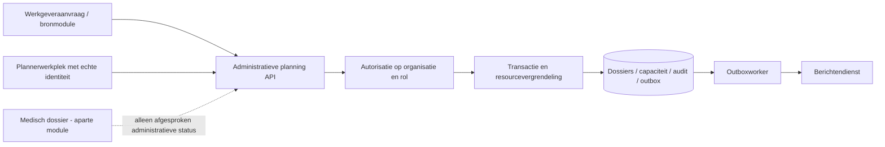
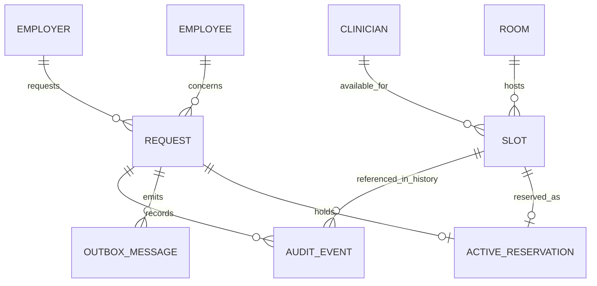

# Data, architectuur en modulegrenzen

Voor de ontwikkelaar die het functionele ontwerp naar een echte omgeving vertaalt. Dit document onderscheidt gebouwd prototype en voorgestelde productiearchitectuur.

## Gebouwd

Browser → `app.mjs` → `domain.mjs` → browseropslag. De UI roept dezelfde pure domeinfunctie aan als de acceptatietests. De domeinfunctie kloont de toestand en geeft bij een geldige opdracht een nieuwe toestand terug. Bij een fout blijft de input ongewijzigd.

Er is geen applicatieserver. Browseropslag en rolkeuze zijn inspecteerbaar door de bezoeker. Meerdere tabs hebben geen transactiecoördinatie. De demoklok is vast. Deze beperkingen worden in footer en tour genoemd.

## Voorgesteld voor productie

Eén transactionele relationele opslag past bij het doel. Microservices zijn voor deze afgebakende module niet nodig. Stackkeuze volgt de bestaande productarchitectuur; deze case veronderstelt geen programmeertaal of database van een werkelijke leverancier.

## Logisch datamodel

| Entiteit | Sleutel / attributen | Eigenaar / bron |
|---|---|---|
| Request | id, employeeId, employerId, type, workpost, status, version | Planningmodule; werknemer/werkgever-ID uit bronmodule |
| Slot | id, startUTC, endUTC, clinicianId, roomId, supportedTypes | Roosterbeheer |
| ActiveReservation | requestId, slotId; maximaal één actief per dossier | Planningmodule |
| AuditEvent | id, requestId, action, actorId/role, timeUTC, vorige/nieuwe slot-ID | Planningmodule, beschermde append-only opslag |
| OutboxMessage | id, requestId, event, deliveryState, retryCount, nextAttemptAt | Integratiebeheer |

De demo gebruikt `slotId` op het dossier als vereenvoudiging van ActiveReservation. Afgesloten en geannuleerde dossiers hebben geen actieve reservering; historische slotreferenties blijven in gebeurtenissen.

## Concurrencyontwerp dat de demo niet bewijst

Een `version`-check beschermt één dossier, maar niet twee verschillende dossiers die tegelijk dezelfde arts boeken. In productie: begin transactie, vergrendel of constraint de relevante resource-intervallen, controleer overlap opnieuw, leg reservering en versie atomair vast, schrijf audit en outbox, commit. Voeg een integratietest toe met twee gelijktijdige requests op verschillende dossiers; precies één krijgt succes.

Idempotentie wordt in productie gescoped op actor/tenant en request-key, met atomische opslag en afgesproken retentie. De demo bewaart sleutels alleen lokaal. Een timeout betekent niet automatisch dat de transactie is mislukt; dezelfde sleutel opnieuw aanbieden kan herstel veilig maken.

Vorige: [proces](../03-processes/processes.md). Volgende: [integratiecontract](../05-integration/contract.md).
